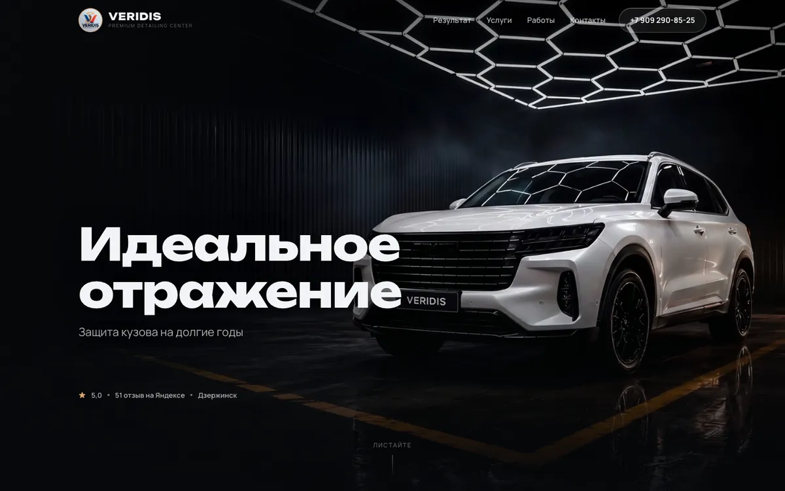
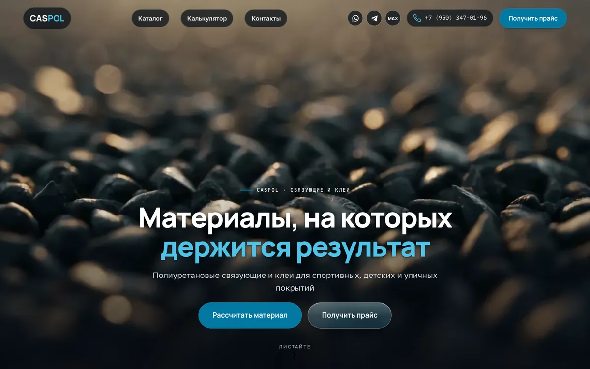
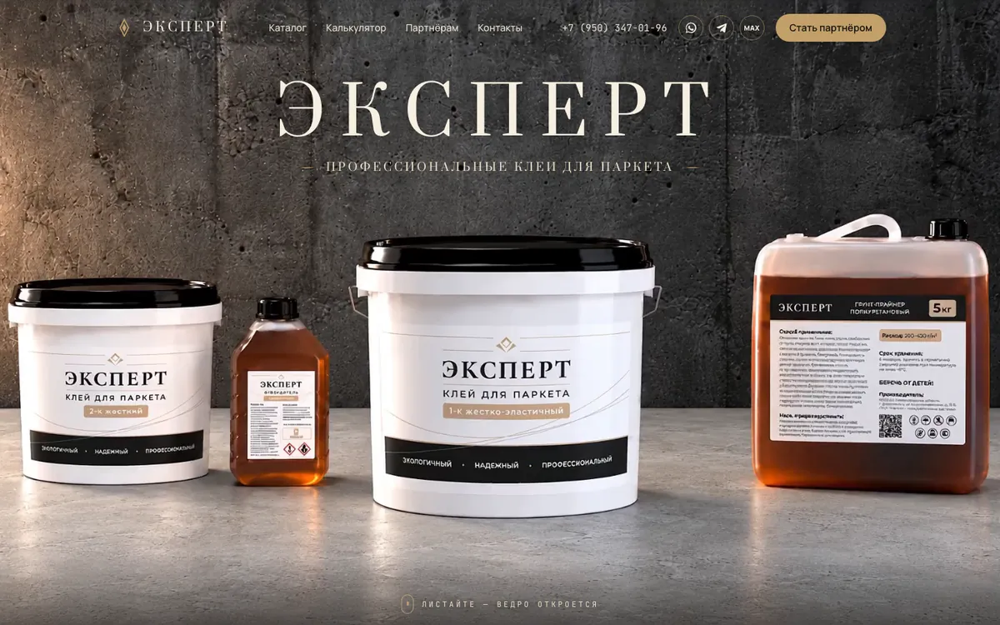
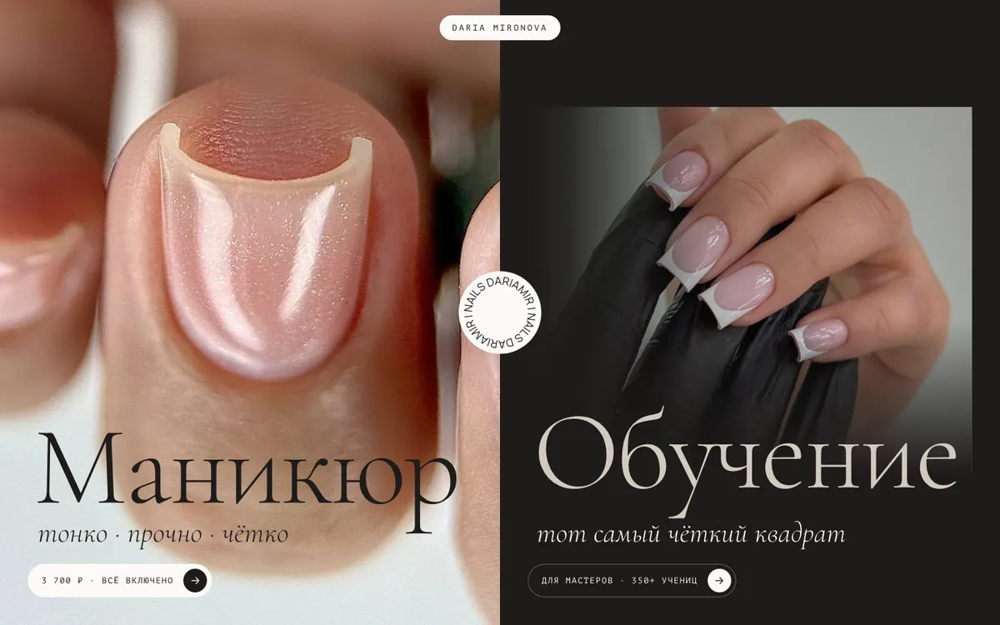
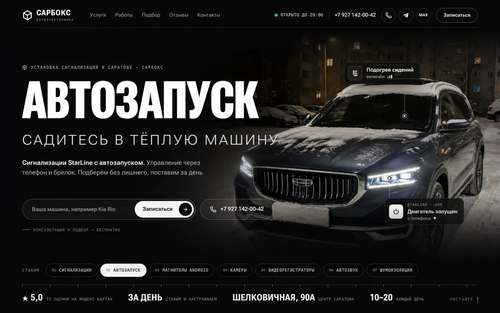

Вот шесть лендингов, которые мы сделали в 2026 году: два детейлинга, установочный центр в Саратове, студия маникюра и два сайта завода CASPOL. Все они работают, каждый можно открыть по ссылке и пролистать самому. Ниже про каждый: какую задачу решал бизнес, что человек видит на первом экране и какие блоки подводят его к записи.

::: stats
6 | живых сайтов в разборе | детейлинг, автоэлектроника, маникюр, завод
4 из 6 | считают цену или расход прямо на странице | конструктор, калькулятор, подбор
3 из 6 | начинаются с ролика, который идёт при прокрутке | VERIDIS, CASPOL и ЭКСПЕРТ
:::

## Шесть примеров в одной таблице

| Сайт | Ниша | Первый экран | Главная кнопка |
|---|---|---|---|
| [Интеллект](https://intellectdetailing.ru) | оклейка, тонировка | три услуги крупно | Рассчитать оклейку |
| [VERIDIS](https://veridis52.ru) | детейлинг | ролик с фарами | Консультация |
| [CASPOL](https://sport.caspol.ru) | клеи для покрытий | ролик с объектами | Рассчитать материал |
| [ЭКСПЕРТ](https://expert.caspol.ru) | клеи для паркета | ролик с ведром клея | Стать партнёром |
| [DARIA MIRONOVA](https://darinail.ru) | маникюр, обучение | две половины | Записаться онлайн |
| [СарБокс](https://sarbox.ru) | автоэлектроника | семь вкладок услуг | Записаться |

Все шесть устроены как лендинги: страница ведёт к одному действию. У двух к главной добавлены отдельные страницы под услуги, про них расскажем ниже.

## Интеллект: оклейка, тонировка и автозапуск

Студия в Нижнем Новгороде делает больше десяти услуг, главных у неё три: оклейка кузова полиуретаном, тонировка и сигнализация с автозапуском. Сайт должен сразу показать эти три и дать прикинуть цену оклейки до звонка.

На первом экране три слова «Оклейка. Тонировка. Автозапуск.» и строка о том, что получает владелец машины: кузов без сколов, салон без жары, зимой тёплая машина к выходу. За текстом фото Genesis G80 в боксе студии под сотовым светом. Кнопок две, «Рассчитать оклейку» и «Записаться на осмотр», а под ними рейтинг с Яндекс Карт, часы работы и подарок при полной оклейке.

Что работает на заявку:

- **Конструктор оклейки.** На схеме машины нажимаете капот, бампер, фары, зеркала или весь кузов и сразу видите сумму. Расчёт попадает в заявку, переписывать его не нужно.
- **Цены на главной.** У оклейки и сигнализации стоит цена «от», у тонировки цена за машину, у дополнительных услуг вроде антихрома и полировки тоже цифра. Рядом написано, что точную стоимость студия называет после осмотра.
- **Связь из шапки.** На телефоне в шапке три значка: позвонить, Max и Telegram. Шапка едет вместе со страницей, поэтому значки под рукой на любом блоке.

Кроме главной, у оклейки, тонировки и автозапуска есть свои страницы, чтобы каждую услугу можно было найти в поиске отдельно.

**Кому подходит:** детейлингу и студиям тонировки, у которых две-три главные услуги и цена складывается из деталей.

## VERIDIS: детейлинг в Дзержинске

Это первый сайт VERIDIS. Услуг у центра много, от химчистки до шумоизоляции. Сильных направлений два: защита кузова плёнкой и свет, то есть установка Bi-LED и Tri-LED модулей в фары.

Первый экран начинается с ролика, который идёт при прокрутке: машина стоит в тёмном боксе под сотами света, потом загораются фары. Поверх ролика заголовок «Идеальное отражение», под ним две услуги с ценой «от», «Броня для кузова» и «Идеальный свет», а рядом адрес, рейтинг на Яндексе и кнопки «Консультация» и «Позвонить».

Что работает на заявку:

- **Карта услуг на фото машины.** На кадре стоят точки: салон, тонировка, полировка, оптика и свет, шумоизоляция, оклейка. Наводите на точку и видите, что входит в направление и сколько стоит.
- **До и после.** Шторка на фото фары: мутная до восстановления, прозрачная после.
- **Видео и цифры студии.** В раскрытых услугах и в блоке «О нас» идут ролики самого центра, рядом сколько лет он работает, сколько машин в месяц проходит через бокс и какая гарантия на оклейку.

Кнопка «Написать во ВКонтакте» открывает сразу диалог с сообществом: центр привык принимать заявки там, и сайт мы подстроили под этот канал.

**Кому подходит:** детейлингу с широким прайсом, у которого есть свои фото и видео работ.

## CASPOL: связующее и клеи для спортивных покрытий

Завод в Дзержинске выпускает три материала для четырёх видов объектов: связующее CASPUR 4000 для резиновой крошки и клеи CASPOL 140 и 144 для искусственного газона и рулонных покрытий. Покупатель приходит со своим объектом, будь то детская площадка, поле или зал, и ему нужно быстро найти свой материал и посчитать объём.

На первом экране заголовок «Материалы, на которых держится результат», кнопки «Рассчитать материал» и «Получить прайс» и ролик при прокрутке. Он начинается с крупного плана резиновой крошки, а по ходу появляются подписи: детские площадки, стадионы, спортзалы, резиновая плитка, у каждой название материала.

Что работает на заявку:

- **Отдельная сцена под каждый объект.** Заголовок о пользе, например «Шов, который не разойдётся», три цифры из техданных и две кнопки: запросить цену и рассчитать.
- **Калькулятор расхода.** Выбираете материал, тип покрытия, площадь и толщину слоя и видите, сколько килограммов связующего и крошки понадобится. Расчёт уходит менеджеру вместе с заявкой.
- **Форма с объектом и площадью.** Менеджер ещё до звонка знает, о чём пойдёт разговор.

**Кому подходит:** производителям и поставщикам материалов, где покупатель считает объём под конкретный объект.

## ЭКСПЕРТ: клеи для паркета

Вторая линейка того же завода, клеи для паркета. Этот сайт сделан для дилеров, то есть для тех, кто будет продавать клей ЭКСПЕРТ в своём регионе.

На первом экране тоже ролик. Он идёт при прокрутке, а подсказка на экране говорит: «листайте — ведро откроется». Крышка ведра открывается, клей выливается, по ходу идут три подписи: держится надёжно, наносится легко, работает стабильно. В конце фраза «Покупайте клей, которому доверяют профессионалы» и кнопки «Стать партнёром» и «Смотреть каталог».

Что работает на заявку:

- **Каталог вкладками.** Пять клеёв и грунт-праймер, у каждого твёрдость, прочность, упаковка и где его использовать.
- **Сравнение в одной таблице.** Эластичность, прочность и твёрдость всех клеёв стоят рядом, и видно, чем один отличается от другого.
- **Калькулятор расхода.** По клею, шпателю и площади считает килограммы и число вёдер, отдельной строкой грунт в канистрах.

Форма для дилера короткая: имя, компания, телефон и город.

**Кому подходит:** производителю с линейкой похожих товаров, который продаёт через дилеров или оптом.

## DARIA MIRONOVA: маникюр и обучение мастеров

Студия в Ивантеевке делает две разные вещи: маникюр для клиенток и обучение мастеров. Вопросы у них разные. Поэтому сайт начинается с развилки, и экран поделён на две половины, «Маникюр» с ценой 3 700 ₽ «всё включено» и «Обучение» для мастеров с подписью «350+ учениц». Нажимаете на половину, и она раскрывается в свою страницу.

Что работает на запись:

- **Одна цена крупно.** На странице маникюра первым делом 3 700 ₽ и кнопка «Записаться онлайн». Ниже чек с тем, что входит в цену: снятие, укрепление гелем, ремонт трещин, покрытие.
- **Проблемы, которые решает мастер.** Четыре карточки, например «Форма квадрат не будет расклешённой», и фото до и после. Тексты мастер писала сама, от первого лица.
- **Курс расписан по часам.** На странице обучения день курса по времени, программа из 10 тем, работы учениц, отзывы и стоимость.

Отзывы на странице маникюра стоят скриншотами, в том виде, в каком они пришли мастеру.

**Кому подходит:** мастеру или небольшой студии с одной главной услугой и понятной ценой, особенно если рядом есть второе направление.

## СарБокс: сигнализации и автозвук в Саратове

Установочный центр ставит сигнализации StarLine с автозапуском, магнитолы, камеры, регистраторы, автозвук и шумоизоляцию. Главная услуга у центра — сигнализации, но на первом экране нужно было показать и остальные шесть направлений.

Первый экран переключается, как пресеты на магнитоле: семь вкладок, у каждой свой кадр и заголовок вида «Автозапуск — садитесь в тёплую машину». На кадрах плашки-уведомления, например «Двигатель запущен с телефона» или «Камера включилась сама». Зимой первой открывается вкладка «Автозапуск», летом «Сигнализации», а на первом экране всегда есть поле «Ваша машина» и кнопка записи.

Что работает на заявку:

- **Подбор комплекта.** Отмечаете марку, год и что нужно: автозапуск с брелока или с телефона, поиск по GPS, магнитолу, регистратор. Сайт показывает пример модели StarLine и цену «от и до», а кнопка отправляет всё в Telegram готовым сообщением.
- **Работы с моделями.** Восемь машин из их бокса, под каждой марка и модель сигнализации.
- **Вопросы перед установкой.** Девять ответов: сколько стоит, сколько времени займёт, какую сигнализацию выбрать, какая гарантия.

**Кому подходит:** установочным центрам и автосервисам, у которых несколько услуг и спрос меняется по сезону.

## Из чего состоит лендинг, который ведёт к заявке

Ниши у шести сайтов разные, а набор блоков почти один и тот же:

1. **Первый экран.** Что вы делаете и что получает клиент, фото или ролик из вашего бокса или студии, кнопка записи. Рядом цена «от» или рейтинг.
2. **Услуги с ценами.** Цифра «от» и от чего она зависит. Если точную цену называете после осмотра, так и пишем.
3. **Расчёт.** Конструктор, калькулятор или подбор, когда цена складывается из частей. Расчёт уходит в заявку вместе с контактами.
4. **Работы.** Ваши фото с подписями: какая машина и что сделали.
5. **Отзывы.** Скриншоты или цитаты с Карт и ссылка на карточку.
6. **Как мы работаем и вопросы.** Сроки, гарантия, что будет после записи.
7. **Контакты.** Телефон и мессенджеры в шапке на телефоне, адрес и кнопка маршрута.

Чем лендинг отличается от визитки и многостраничного сайта и что выбрать под ваш бизнес, мы разобрали в статье [визитка, лендинг или многостраничный сайт](/blog/sajt-vizitka-lending-ili-mnogostranichnyj/). Из чего складывается цена, рассказали в статье [сколько стоит лендинг](/blog/skolko-stoit-lending/). У нас лендинг стоит от 30 000 ₽ за 7 дней, первый экран показываем бесплатно, до оплаты.

::: cta
:::

## Частые вопросы

### Как выглядит лендинг?

Это одна длинная страница, которая ведёт к одному действию: записаться, оставить заявку или написать в мессенджер. Сверху первый экран с услугой и кнопкой, ниже цены, работы, отзывы, вопросы и контакты. Шесть примеров выше можно открыть по ссылкам и пролистать на телефоне или компьютере.

### Как выглядит сайт-визитка?

Это одна или несколько страниц о компании: чем занимается, список услуг, адрес и телефон. Цен, расчёта и записи на визитке обычно нет. Её задача — подтвердить, что компания существует, и дать контакты.

### Что такое мини-лендинг?

Так называют короткий лендинг из трёх-пяти блоков: первый экран, услуга с ценой, отзывы и контакты. Его делают под одну услугу или акцию, когда показывать много не нужно. Калькулятора и большого раздела вопросов в нём обычно нет, зато его быстрее сделать и проще держать в порядке.

### Лендинг — это всегда одна страница?

Главное в лендинге — одно действие. У «Интеллекта» к главной добавлены страницы оклейки, тонировки и автозапуска, у студии маникюра свои страницы для клиенток и для мастеров. Каждая устроена как лендинг и ведёт к записи.

### Сколько стоит такой лендинг?

У нас от 30 000 ₽ за 7 дней, первый экран показываем бесплатно, до оплаты. В цену входят дизайн под вашу нишу, тексты, мобильная версия и подключения. Сайт с роликом на первом экране стоит дороже, потому что каждую сцену ролика мы продумываем отдельно.

## Подробности

- **Сайты:** все шесть открыты и пролистаны 12 ноября 2026 года, описано то, что на них есть в этот день.
- **Работы:** проекты МирВеба, запущены с августа по ноябрь 2026 года.
